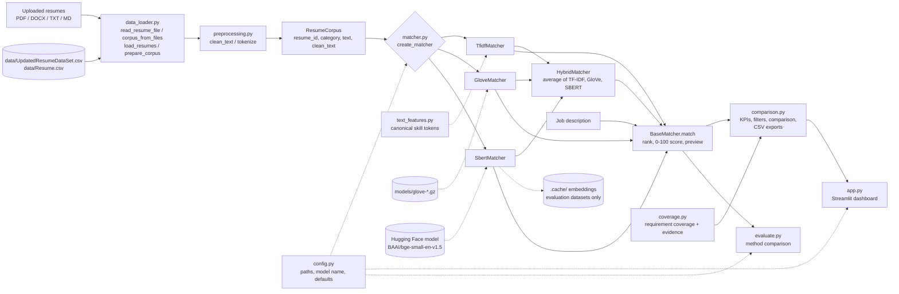

# Resume Matcher

Rank uploaded resumes against a job description using three NLP text-similarity techniques
(**TF-IDF**, **GloVe** word embeddings and **Sentence-BERT**) plus a **Hybrid** that averages all
three, through one shared interface and a Streamlit recruitment-analytics dashboard with KPIs,
charts, a shortlist and side-by-side comparison of up to five candidates.

---

## 1. Problem statement

Recruiters often receive far more resumes than they can read closely. Keyword search
misses candidates who describe the same skill in different words, and reading every
resume by hand is slow. This project explores how well different text-representation
techniques can **rank a pool of resumes by their similarity to a job description**, so a
human reviewer can start with the most relevant ones.

## 2. Objectives

1. Load and clean real public resume datasets: a tech-focused one (software, data, DevOps, QA roles) and a
   general one (2,484 resumes across 24 industries).
2. Implement three matching methods behind one interface:
   lexical (TF-IDF), averaged word embeddings (GloVe), and sentence embeddings (Sentence-BERT),
   plus a hybrid that averages the scores of all three.
3. Provide a web app to upload resumes, enter a job description, view ranked resumes, and compare and
   shortlist candidates using evidence taken from the resumes.
4. Compare the methods reproducibly on the same resumes and job descriptions.
5. Handle missing data, models and packages without crashing or giving misleading results.

## 3. Features

| Feature | Status |
|---|---|
| Dataset loading with automatic column detection (text / category / ID) | ✅ Implemented |
| Two real datasets for evaluation (tech roles / all industries) | ✅ Implemented |
| Repair of broken characters in the data (e.g. `Naïve` → `Naïve`) | ✅ Implemented |
| Handling of missing file, empty file, null text, malformed rows, duplicates | ✅ Implemented |
| Shared text preprocessing that keeps terms like `c++`, `c#`, `node.js`, `r` | ✅ Implemented |
| TF-IDF text preparation: skill aliases spelled one way (`k8s` → Kubernetes, `sklearn` → scikit-learn), multi-word skills as one token, "IT", front-/back-end and full-stack kept, number-only tokens dropped | ✅ Implemented |
| TF-IDF + cosine similarity matching, IDF fitted on all resumes plus the job description | ✅ Implemented |
| GloVe average-embedding matching, with the shared "common direction" removed so scores spread out | ✅ Implemented (needs a ~134 MB download, see §10) |
| Sentence-BERT matching (`BAAI/bge-small-en-v1.5`, configurable): whole resume plus section-aware chunks, so long resumes are read to the end | ✅ Implemented (model downloads on first use) |
| Hybrid matching: TF-IDF, GloVe and Sentence-BERT rescaled to one scale per run, configurable weights (default in the app) | ✅ Implemented |
| Requirement-level semantic evidence (Sentence-BERT): related wording for capability requirements, shown as unverified | ✅ Implemented |
| "Ranking by method" view: the same resumes ranked by every available method, with agreement | ✅ Implemented |
| On-disk cache of Sentence-BERT embeddings for the evaluation datasets (never for uploaded resumes) | ✅ Implemented |
| Clear "unavailable" status when GloVe/SBERT resources are missing | ✅ Implemented |
| Streamlit app: upload several resumes (PDF/DOCX/TXT/MD), one empty job-description box, method selector | ✅ Implemented |
| Every readable resume is ranked; "Number of Top Resumes to Display" (any whole number, 5 by default, capped at the number ranked) then selects the top K that the whole dashboard (KPIs, ranking, insights, comparison, CSV) analyses | ✅ Implemented |
| PDF (`pypdf`) and Word .docx text extraction for uploaded resumes (DOCX read with the standard library) | ✅ Implemented |
| Ranked results table with similarity score and contact-masked preview | ✅ Implemented |
| Per-resume card: job requirements *Included in Resume* / *Not Found in Resume* | ✅ Implemented |
| CSV download of results | ✅ Implemented |
| Job-description requirement coverage, separate from similarity: skills (exact match, recognised alias, related but unverified, missing), degree level and years of experience, each match with a quote from the resume | ✅ Implemented |
| Dashboard KPIs: resumes uploaded, processed, failed, ranked, strong matches (configurable threshold), average similarity, average coverage, requirements checked | ✅ Implemented |
| Charts from the current run: score by candidate, score distribution, similarity vs coverage, requirements found, requirement coverage | ✅ Implemented |
| Ranking search (file name or skill), sort (rank, score, coverage, requirements, name) and filters (shortlisted, strong, must mention, optional minimum similarity / coverage) | ✅ Implemented |
| Candidate comparison of 2–5 candidates from the same run: score bars, skills, experience/education quotes, keywords, resume text, original file | ✅ Implemented |
| Candidate × requirement matrix and shared-skills view | ✅ Implemented |
| Deterministic, evidence-based comparison summary (no LLM, no hiring recommendation) | ✅ Implemented |
| Session-only shortlist with a "Shortlisted" filter | ✅ Implemented |
| Comparison CSV and skill-matrix CSV export (UTF-8, quoted, formula-safe) | ✅ Implemented |
| Evaluation script (timing + category-based Precision@K) | ✅ Implemented |
| Automated tests (pytest, 280 tests; real-model checks are skipped when the models are not on the machine) | ✅ Implemented |
| OCR for scanned PDFs, old binary Word (.doc) files | ⏳ Not implemented |
| Human-labelled relevance judgments | ⏳ Not available |

## 4. Technologies

Python 3.13 (3.10+ should work), pandas, NumPy, scikit-learn (TF-IDF), pypdf (PDF text), pretrained GloVe vectors
(`glove-wiki-gigaword-100`), sentence-transformers / PyTorch (Sentence-BERT), Streamlit (UI) with Altair
charts (installed with Streamlit), pytest (tests).

## 5. System architecture



Core logic lives in the `resume_matcher/` package and has no UI code; `comparison.py` builds the
per-candidate view of one ranking without changing its scores, using `coverage.py` for the requirement checks. `app.py` (UI),
`evaluate.py` (comparison) and `explore_data.py` (data analysis) only call into it.
The app ranks resumes the user uploads; the two datasets are used by `evaluate.py` and `explore_data.py`.

## 6. Processing workflow

1. **Load**: in the app, extract the text of each uploaded file (PDF via `pypdf`, DOCX from its
   `word/document.xml`, TXT/MD decoded as UTF-8 or Windows-1252) and use the file name as the resume ID; for evaluation, read the dataset CSV
   and detect the text/category/ID columns. Both paths then repair broken characters, drop resumes that
   are empty after cleaning, drop exact duplicates, and keep the original text for display.
2. **Preprocess**: lowercase, remove URLs and e-mail addresses, remove punctuation except `+ # .`
   inside terms, and collapse whitespace. Resumes and job descriptions use the same function. TF-IDF
   additionally spells each known skill one way (`text_features.py`, see §7).
3. **Index** (once per method): build TF-IDF vectors / GloVe document vectors / SBERT embeddings
   for all resumes.
4. **Query**: transform the job description in the same way and compute cosine similarity with
   every resume.
5. **Rank**: sort by similarity (stable sort, so ties keep dataset order) and attach the ID, category,
   a 0–100 score and a contact-masked preview. The app ranks every resume; `evaluate.py` takes the top K.
6. **Coverage** (app): check each of the job's requirements in each resume and keep the evidence
   (`coverage.py`). This is reported next to the similarity score and never changes it.

## 7. Matching algorithms

TF-IDF, GloVe and Sentence-BERT return **cosine similarity**, displayed as `score = max(0, cosine) × 100`.
The Hybrid returns a weighted combination of the three after rescaling each to 0–1 within the run (see below),
also shown on a 0–100 scale; it is relative to the uploaded resumes.
The score measures **text similarity only**. It is *not* a probability of suitability or of being
hired, and scores from different methods are not on comparable scales.

| Method | How it represents text | Strengths | Weaknesses |
|---|---|---|---|
| **TF-IDF** | Sparse vector of word weights: frequent in this resume, rare across all resumes. Known skills and their aliases become one token (`k8s`, `Kubernetes` → `kubernetes`; "machine learning" → `machine_learning`), English stop words are removed except "front", "back", "full" and "system", upper-case "IT" is kept, number-only tokens are dropped, sub-linear TF. The IDF is fitted on all resumes **plus the job description**, so job words that no resume uses still count in its vector (they lower every score equally instead of being dropped, which inflated scores). | Fast (8 ms per query for 2,481 resumes after a one-off ~5 s fit), explainable, no download. | Exact words or known aliases only ("doctor" ≠ "physician"); related technologies are never merged (Flask ≠ Django). |
| **GloVe** | Average of the 100-d pretrained GloVe vectors of a document's known words (a word used twice counts twice), after the same skill-alias normalization as TF-IDF ("Node JS" → "node.js") and keeping "front", "back", "full" and "system". The direction all averaged vectors share is removed (computed once from GloVe's most frequent words, so it does not depend on the upload), then cosine. Out-of-vocabulary words are skipped; a document with no known words scores 0. IDF weighting is available (`GLOVE_WEIGHTING=idf`) but scored lower (§13). | Captures related words; fast (one sparse matrix product for all resumes). | Averaging loses word order; the 2014 vocabulary lacks newer terms (Kubernetes, TensorFlow, PyTorch, DevOps, microservices, C#), which are ignored. |
| **Sentence-BERT** | `BAAI/bge-small-en-v1.5` (384-d, CLS pooling, L2-normalized, as the model is configured). Each resume is embedded whole (the model reads its first 512 word-pieces) and also cut into section-aware chunks of ≤ 256 word-pieces (`chunking.py`); score = 0.5 × whole-resume cosine + 0.5 × best chunk cosine. The job description gets BGE's search instruction ("Represent this sentence for searching relevant passages: "); a job description longer than the limit is chunked and averaged. | Understands related wording and context; relevant text late in a long resume still counts. | Slower: encoding the chunks makes the one-off encoding of an upload 2–7× slower (§13); `SBERT_CHUNK_TOKENS=0` turns chunking off. |
| **Hybrid** (recommended) | Each method's similarities are min-max rescaled to 0–1 within the run, then combined with weights (TF-IDF, GloVe, Sentence-BERT; default equal, set in the app or with `HYBRID_WEIGHTS`). A method that knows none of the job description's words is left out, the remaining weights are rescaled, and the app says so. | Exact skill names, related words *and* overall meaning all count; on the evaluation it is the most consistent method (§13). | The score is relative to the uploaded resumes (the best resume under every method scores 100), so the app shows each method's own score next to it. |

## 8. Repository structure

```
Resume-Matcher/
├── app.py                        # Streamlit dashboard (UI and per-session state only)
├── assets/app.css                # Dashboard styles (loaded by app.py)
├── evaluate.py                   # Compare methods: timing + category Precision@K
├── explore_data.py               # Dataset exploration (shape, nulls, categories, cleaning)
├── resume_matcher/               # Core logic (no UI)
│   ├── config.py                 # Paths, model name, defaults (env-var overridable)
│   ├── data_loader.py            # CSV + uploaded-file (PDF/DOCX/TXT/MD) loading, validation, de-duplication
│   ├── preprocessing.py          # clean_text, tokenize, contact masking, previews
│   ├── text_features.py          # TF-IDF text preparation: canonical skill tokens, kept words
│   ├── skills.py                 # Job-description requirements and which ones each resume mentions
│   ├── matcher.py                # TF-IDF / GloVe / SBERT matchers + create_matcher()
│   ├── coverage.py               # Requirement coverage: skills, degree, years, semantic evidence
│   ├── chunking.py               # Section-aware chunks for Sentence-BERT
│   └── comparison.py             # Candidate rows, KPIs, filters, paging, comparison, summary, CSV exports
├── tests/                        # pytest suite (synthetic fixtures, offline fakes)
├── demo_samples/                 # One job description + seven fictional resumes (TXT, PDF, CSV) + relevance_labels.json
├── data/
│   ├── README.md                 # How to get both datasets
│   └── sample_job_descriptions.json   # 16 hand-written tech job descriptions used by evaluate.py
├── models/                       # Put GloVe vectors here (git-ignored)
├── .streamlit/config.toml        # Upload size limit, telemetry off
├── requirements.txt
└── pytest.ini
```

Generated and git-ignored: `.venv/`, `.cache/` (SBERT embeddings of the evaluation datasets), `results/` (evaluation CSVs),
`data/*.csv`, `models/*`.

## 9. Datasets

Both are real, public Kaggle resume datasets. They are git-ignored (third-party personal data); see
[`data/README.md`](data/README.md) for download steps. They are used for evaluation (§13) and data
exploration; the web app itself only ranks resumes that the user uploads.

| | Tech roles (default) | All industries |
|---|---|---|
| File | `data/UpdatedResumeDataSet.csv` | `data/Resume.csv` |
| Source | Kaggle *Resume Dataset* (gauravduttakiit); MIT-licensed mirror on Hugging Face `brackozi/Resume` | Kaggle *Resume Dataset* by Snehaan Bhawal |
| Columns | `Category`, `Resume` (no ID, so IDs are `row-<n>`) | `ID`, `Resume_str`, `Resume_html`, `Category` |
| Rows → used after cleaning | 962 → **166** (796 exact duplicates removed) | 2,484 → **2,481** (1 empty, 2 duplicates removed) |
| Categories | 25, mostly technical: Java / Python / DotNet / SAP / ETL Developer, Data Science, DevOps Engineer, Testing, Automation Testing, Database, Hadoop, Blockchain, Business Analyst, Web Designing, Network Security Engineer, plus some non-tech | 24 broad industries (INFORMATION-TECHNOLOGY, ENGINEERING, HR, ...); only about 30 resumes have a software/data job title |

Known gaps in the tech dataset: there is no frontend, mobile (Android/iOS) or systems-programming
category (7 resumes mention Android), so those job descriptions are ranked but not scored in §13.

Any CSV with a resume-text column works for evaluation: `python evaluate.py --data /path/to/file.csv`.

## 10. Installation

**macOS / Linux**

```bash
git clone https://github.com/YashAgarwal2309/Resume-Matcher-Project-.git
cd Resume-Matcher-Project-
python3 -m venv .venv
source .venv/bin/activate
pip install -r requirements.txt
```

**Windows (PowerShell)**

```powershell
git clone https://github.com/YashAgarwal2309/Resume-Matcher-Project-.git
cd Resume-Matcher-Project-
py -m venv .venv
.venv\Scripts\Activate.ps1
pip install -r requirements.txt
```

The web app needs no dataset: it ranks the resumes you upload. The datasets (see §9) are only used by
`evaluate.py` and `explore_data.py`.

### Optional: GloVe vectors (~134 MB)

```bash
curl -L -o models/glove-wiki-gigaword-100.gz \
  https://github.com/RaRe-Technologies/gensim-data/releases/download/glove-wiki-gigaword-100/glove-wiki-gigaword-100.gz
```

This is the same `glove-wiki-gigaword-100` model the original script loaded through
`gensim.downloader`; it is read directly, so gensim is not required. The Stanford file
`glove.6B.100d.txt` placed in `models/` also works, or set `GLOVE_PATH`.
Without the file, the app shows GloVe as unavailable.

### Optional: Sentence-BERT

Installed by `requirements.txt`. The default model, `BAAI/bge-small-en-v1.5` (~130 MB), is downloaded from
Hugging Face on first use and cached. The first SBERT run per dataset also encodes all resumes (measured: about
8 s for 166 and 41 s for 2,481 resumes on an Apple-silicon laptop, plus the one-time model download), and
`evaluate.py` saves the dataset embeddings to `.cache/` so later runs only load the model. The web app never
writes embeddings of uploaded resumes to disk; it keeps them in the browser session's memory. The Hybrid method uses the same model
(and also needs the GloVe file).
To use a different model: `export SBERT_MODEL=all-MiniLM-L6-v2` (the previous default). To force CPU:
`export SBERT_DEVICE=cpu`.

### Configuration (environment variables)

| Variable | Default |
|---|---|
| `RESUME_DATA_PATH` | unset: `evaluate.py` uses every dataset in `data/`; set it to use only one CSV |
| `GLOVE_PATH` | `models/glove-wiki-gigaword-100.gz` (or `models/glove.6B.100d.txt`) |
| `SBERT_MODEL` | `BAAI/bge-small-en-v1.5` |
| `SBERT_DEVICE` | auto (CUDA / Apple MPS / CPU); if encoding fails on the GPU it is retried on the CPU |
| `SBERT_CHUNK_TOKENS` | `256`; `0` turns chunking off (whole-resume embedding only, faster) |
| `GLOVE_WEIGHTING` | `mean`; `idf` for damped counts × IDF |
| `HYBRID_WEIGHTS` | `0.333,0.333,0.333` (TF-IDF, GloVe, Sentence-BERT; rescaled to sum to 1) |
| `HYBRID_NORMALIZATION` | `minmax`; `none` for the plain weighted average of cosines |

## 11. Running

```bash
streamlit run app.py          # web app at http://localhost:8501
python explore_data.py        # dataset statistics
python evaluate.py            # compare all methods on every dataset (add --methods tfidf sbert --top-k 10)
```

Auto-reload on file save is turned off in `.streamlit/config.toml` (it floods the console with
harmless `torchvision` tracebacks once Sentence-BERT is loaded), so restart the app after editing code.

**Demo flow:** paste the job description (the app lists the requirements it detects), upload the resumes
(select several PDF/DOCX/TXT/MD files at once), choose an algorithm and click **Match Resumes**. Every
readable resume is ranked. Ready-made demo input: `demo_samples/` (one job description
and seven fictional resumes in `demo_samples/pdf/`).

### Using the dashboard

**Supported resume formats:** PDF with a text layer, Word .docx, TXT and MD, up to 5 MB each. Scanned PDFs
(images only, no OCR) and old binary Word .doc files are not supported; unreadable or empty files are skipped
with a message and counted as *Failed files*.

**Two separate scores.**
- *Similarity* (the score column, 0–100): `max(0, cosine similarity) × 100` between the whole resume and the
  whole job description for the selected method (§7). Scores of different methods are on different scales,
  so compare candidates only within one run.
- *Requirement coverage* (%): the share of the job's checkable requirements that the resume shows evidence
  for (`resume_matcher/coverage.py`). Requirements are the skills named in the job description (skill
  vocabulary plus items listed after "Required:", "experience with" and similar), the degree level it asks
  for ("Bachelor's degree or higher") and the minimum years of experience ("3+ years"). For each resume each
  requirement is *matched* (the resume names it, either exactly or by a recognised alias such as `k8s` or
  `postgres`; a degree at or above the level; or stated years at or above the minimum), *related, unverified*
  (not found, but a related technology is named, e.g. Flask when Django is required; never counted as
  matched), or *not found*. Every match keeps a short quote from the resume as evidence. Years are only
  taken from statements such as "4 years of experience", never added up from dates.

Neither score is a probability of being suitable or hired, and they are never combined.

**KPIs.** *Resumes uploaded*, *Resumes processed* (readable, after exact duplicates are removed), *Failed
files*, *Candidates ranked* (always every processed resume), *Strong matches* (similarity at or above the
strong-match threshold), *Average similarity*, *Average coverage* and *Requirements checked*. The threshold is
set per method with the "Strong match ≥" button; defaults are TF-IDF 20, GloVe 82, Sentence-BERT 70 and
Hybrid 60 (`DEFAULT_STRONG_THRESHOLDS` in `resume_matcher/comparison.py`). They separate the three Data
Science resumes in `demo_samples/` from the rest for every method; they are a starting point, not a
calibrated cut-off. Changing the threshold never changes the ranking.

**Top K.** Every resume is ranked first. *Number of Top Resumes to Display* (5 by default), above the
statistics, then selects the K best-ranked resumes for the chosen method, e.g. "Showing 5 of 7 ranked
resumes", and the whole dashboard works from that one selection: the score and coverage statistics, the
ranking table, every Insights chart (including the ranking by method), the candidates that can be compared
and the results CSV. The other resumes stay ranked and keep their scores (and any shortlisting); they are
only left out until K is raised. Any whole number from 1 up to the number of ranked resumes is accepted; a
larger number selects all of them, an emptied field returns to 5, decimals are rounded down and numbers
below 1 are rejected. A new ranking (another method or job) selects a new top K.

**Ranking tab.** Shows the top K with pages of 25. Search by file name or skill; sort by rank, similarity, coverage,
requirements found or name; filter to shortlisted candidates, strong matches, resumes that match chosen
requirements, or an optional minimum similarity / coverage (0 = off). The table shows rank, similarity,
coverage, matched / related / missing requirements and the method. Each candidate's card lists every
requirement with its status and evidence, the experience and degree phrases quoted from the resume (or *Not
available*), keywords shared with the job description, and a contact-masked preview.

**Method details.** Hybrid runs add each method's own score (0–100) as columns and in each card;
Sentence-BERT (alone or in the Hybrid) adds the whole-resume score and the best-matching resume section
with its text. A Hybrid run that had to leave a method out says which and why.

**Semantic evidence.** For Sentence-BERT and Hybrid runs, a capability requirement that the resume does not
name ("REST APIs", "Unit Testing", "deploying models as APIs") is compared with each resume sentence; when
one is close enough it is shown as *semantically related, not verified*, quoting that sentence. It is never
counted as a match and never changes coverage. It is not looked for with product names (Python, Django,
AWS), where similar wording is not evidence. The threshold is strict (§13), so it shows few, well-supported
lines; it is computed for the candidates on screen only.

**Insights tab.** All for the top K only: similarity score by candidate and requirements found per resume
(at most 50 bars), the score distribution, similarity against coverage, and how many of the top K resumes
match each requirement. *Ranking by method* ranks every resume with every available method (loading GloVe or
Sentence-BERT if needed), then shows the top K's rank per method (among all ranked resumes), the spread, and
how well the methods agree on them (Kendall's tau, top-10 overlap).

**Compare tab.** Choose 2 to 5 of the top K candidates in *Candidates to compare* (or with *Add to comparison* on a
card) and click **Compare Candidates**. All of them come from the same run, so they share one job
description, one method and one score scale. You get a short summary that states its criteria (score,
requirements found, shared and unique skills), one card per candidate (similarity and coverage bars,
requirements matched, related and not found with their evidence, experience, education, keywords, parsed
resume text and the original uploaded file), a score chart, a shared-skills panel and a candidate ×
requirement matrix (Found / Related (unverified) / Not found). "Not found" means the resume text does not
mention it; the candidate may still have that skill.

**Shortlist.** Use the *Shortlisted* toggle on any card. A shortlist belongs to one set of uploaded resumes
plus one job description: it survives re-running or switching the method, while different uploads or a
different job description start a separate shortlist. It lives only in the browser session.

**Exports.** *Download results as CSV* exports every result in view (all pages of the current limit and
filters): the earlier columns (rank, resume_id, score, cosine_similarity, preview, method) followed by
coverage_percent, requirements_matched, matched_requirements, related_unverified, missing_requirements,
evidence and shortlisted. *Download Comparison CSV* has one row per compared candidate (candidate, rank,
similarity score, method, requirements found, coverage, matched / unconfirmed / related skills, evidence,
experience and education phrases, shortlist status) and *Download Skill Matrix CSV* is requirement ×
candidate ("found" / "related (unverified)" / "not found"). All exports are UTF-8 with a BOM so spreadsheet apps
show accents correctly, quote commas, quotes and line breaks, and prefix cells that start with `=`, `+`, `-`
or `@` with `'` so they are not run as formulas. They contain candidate information: store and share them
carefully.

**Stale results.** Uploading different resumes clears the results. Editing the job description or method
keeps the old results on screen with a notice until **Match Resumes** is clicked again;
every new run resets the comparison selection.

## 12. Testing

```bash
python -m pytest            # 280 tests, about 25 s (the 3 real-model checks are skipped if the models are absent)
```

The tests use tiny **synthetic** resumes (in `tests/conftest.py`), not the real dataset, plus fake
GloVe vectors and a fake sentence model, so they need no downloads. They cover dataset loading
(valid, missing, empty, header-only, malformed rows, nulls, duplicates, missing metadata),
preprocessing (including broken-character repair), reading uploaded PDF/TXT/MD resumes (with a tiny
generated PDF), the dataset list, the
evaluation script, score bounds, descending ranking, top-K limits, identical output columns across all
matchers, the hybrid's weighting and fallback, the BGE query instruction, unavailable GloVe file, missing `sentence-transformers` package, a simulated model
download failure, embedding caching, and the Streamlit UI (via `streamlit.testing.AppTest`: empty start,
multi-file upload, unreadable files, results cleared when uploads change). `tests/test_comparison.py` and the
dashboard tests in `tests/test_app.py` cover selecting 2–5 candidates (and refusing 0, 1 or 6), duplicate file
names, empty text, jobs without requirements, the evidence extraction, the summary, CSV escaping and
formula-safety, scores shown equal to `BaseMatcher.match`, KPIs and the threshold, search and filters, the
shortlist, the stale-results notice, a new run clearing the comparison, and that uploaded resumes are never
cached on disk. `tests/test_tfidf.py` checks the TF-IDF text preparation (aliases, kept technical terms,
related technologies kept apart, noise removal), that scores equal a scikit-learn `TfidfVectorizer` fitted
on the resumes plus the job description, that job words found in no resume lower every score by the same
factor, keyword stuffing, and that 4, 30, 50, 100, 250 and 1,000 resumes are all ranked with each score
attached to the right file. `tests/test_coverage.py` covers exact / alias / related / missing requirements,
evidence quotes, degree and years parsing, and that Flask is never counted as Django. The dashboard tests
also upload 60 resumes and check "Number of Top Resumes to Display" (best 5 / 3 / 7 of 7, 10 capped at 7, invalid numbers, unchanged
ranks and scores, pages, CSV and filters) and that, for K = 5, 3 and 7, the statistics, ranking, every
Insights chart, the ranking by method, the comparison picker, the Compare tab and the CSV use exactly the top K, and check DOCX uploads, failed-file counts and the
optional minimum-score filter. `tests/test_embeddings.py` covers the GloVe table (one matrix, loaded once, malformed or incomplete files
reported), word lookup, out-of-vocabulary and empty documents, optional IDF weighting, removal of the common
direction, chunking (sections, limits, nothing lost), long resumes matched on later sections, normalized
embeddings, long job descriptions, the GPU-to-CPU and offline-cache fallbacks, the Hybrid formula, weights and
skipped methods, 30 to 1,000 resumes ranked by every method with scores tied to the right file, duplicates,
semantic evidence (never counted, never for products or contact lines) and the ranking-by-method tables.
`tests/test_real_models.py` checks the real GloVe file, BGE's pooling and the semantic threshold against
hand-labelled real resume lines; it is skipped when the models are not on the machine.

## 13. Evaluation

`python evaluate.py` runs every method on every available dataset with the **16 hand-written tech job
descriptions** in `data/sample_job_descriptions.json`: SDE, SWE, Application, Backend, Frontend,
Full-Stack, Mobile (Android/iOS) and Systems Software roles, plus Data Analyst, Data Scientist/ML Engineer,
AI Engineer (NLP), IT Business Analyst, DevOps, QA/Automation Test, Database Developer and Data Engineer.

**Important:** the datasets have **no human relevance judgments**. As a proxy, a resume counts as
"relevant" if its dataset `Category` is in the job's `relevant_categories` (for example
*Backend Developer* → Java / Python / DotNet Developer). This is a rough sanity check, not a true accuracy
measure, and the category mapping is our own judgement. Jobs with no fitting category in a dataset
(Mobile and Systems Software in both; most data/QA/DevOps roles in `Resume.csv`) are ranked but not scored.

Results re-measured on 30 Oct 2026 after the TF-IDF, GloVe, Sentence-BERT and Hybrid changes below (Apple-silicon
Mac, K = 5; reproducible, since all methods are deterministic). Recall@5 is the share of all relevant resumes
found in the top 5 (low on `Resume.csv`, where each job has dozens of relevant resumes); NDCG@5 also rewards
placing relevant resumes higher. Timings exclude the one-time model download; "build" for Sentence-BERT is
first-run encoding (later runs load cached embeddings).

**Tech roles dataset (166 resumes, 14 of 16 jobs scored)**

| Method | Precision@5 | Recall@5 | NDCG@5 | Top-1 relevant | Index build | Mean query |
|---|---|---|---|---|---|---|
| TF-IDF | 0.771 | 0.304 | 0.815 | 13 / 14 | 0.17 s | 0.012 s |
| GloVe (100-d) | 0.529 | 0.217 | 0.551 | 8 / 14 | 4.6 s (incl. loading 400k vectors) | 0.012 s |
| Sentence-BERT (bge-small + chunks) | **0.857** | **0.356** | **0.894** | **14 / 14** | 13.1 s first run | 0.024 s |
| Hybrid (equal weights, rescaled) | 0.829 | 0.349 | 0.876 | **14 / 14** | 0.4 s (embeddings cached) | 0.024 s |

**All industries dataset (2,481 resumes, 6 of 16 jobs scored)**

| Method | Precision@5 | Recall@5 | NDCG@5 | Top-1 relevant | Index build | Mean query |
|---|---|---|---|---|---|---|
| TF-IDF | 0.200 | 0.008 | 0.254 | 3 / 6 | 4.5 s | 0.20 s |
| GloVe (100-d) | **0.400** | **0.017** | **0.447** | 3 / 6 | 2.9 s | 0.19 s |
| Sentence-BERT (bge-small + chunks) | 0.333 | 0.014 | 0.329 | 2 / 6 | 214 s first run | 0.22 s |
| Hybrid (equal weights, rescaled) | 0.333 | 0.014 | 0.390 | **4 / 6** | 11.3 s (embeddings cached) | 0.22 s |

**Hand-labelled demo resumes (7 resumes × 4 jobs, graded 0–3, `demo_samples/relevance_labels.json`)**

| Method | Mean NDCG@5 | Strong-fit resume ranked first |
|---|---|---|
| TF-IDF | 0.985 | 4 / 4 |
| GloVe | 0.992 | 4 / 4 |
| Sentence-BERT | 0.975 | 4 / 4 |
| Hybrid | **0.998** | 4 / 4 |

Observations (not general conclusions; 14, 6 and 4 queries are too few):
- On the tech dataset (the project's focus) Sentence-BERT is now the strongest single method and the Hybrid is
  close behind; both put a relevant resume first for all 14 scored jobs. On `Resume.csv` GloVe has the best
  precision and the Hybrid the most relevant first results (4 / 6), and the Hybrid has the best NDCG on the
  hand-labelled demo set. No single method wins everywhere; the Hybrid is never far from the best.
- On `Resume.csv` all methods score low because it contains few real software resumes and its categories are
  broad industries. Differences there are one or two resumes out of 30 and should not be over-read.
- Per-job rankings are saved to `results/evaluation_per_job.csv` and `results/evaluation_labelled.csv`.

### TF-IDF audit (30 Oct 2026)

Problems found in the previous TF-IDF pipeline and what changed:

| Problem | Effect | Change |
|---|---|---|
| The app passed "Candidates to display" (capped at 50) to `match(top_k=...)` | With more than 50 uploads, resumes after rank 50 were never ranked or shown | Every readable resume is ranked; Top 30/50/100/All and pages only change the view |
| The vectorizer was fitted on the resumes only | Job words that no resume uses were dropped from the job's vector, inflating every score | IDF fitted on resumes + job description (identical to `TfidfVectorizer` on that corpus, checked to 1e-15); scores are lower, the order is unchanged by this step |
| scikit-learn's stop-word list | "front-end", "back-end", "full-stack", "system design" and "IT" lost their key word | "front", "back", "full", "system" kept; upper-case "IT" becomes its own token |
| Hyphens and slashes split skill names; aliases were separate words | `scikit-learn` → "scikit learn", `CI/CD` → "ci cd"; `k8s` never matched "Kubernetes" | Known skills and aliases become one canonical token (text_features.py); related technologies stay separate |
| Number-only tokens (years, phone fragments) were features | Noise | Dropped |
| Previews masked the whole resume text for every result | 973 ms of a 984 ms query for 2,481 resumes | Only the start is masked (identical output, checked on 5,294 texts): 181 ms |

Settings compared on both datasets (14 and 6 scored jobs; one resume moves P@5 by 0.014 / 0.033, so most
differences below are within noise):

| Variant | Tech P@5 | Tech P@10 | Tech top-1 | All-ind. P@5 | All-ind. top-1 | Vocabulary (all-ind.) |
|---|---|---|---|---|---|---|
| Previous pipeline | 0.786 | 0.679 | 12 / 14 | 0.267 | 2 / 6 | 42,821 |
| + job description in the fit | 0.786 | 0.679 | 12 / 14 | 0.267 | 2 / 6 | 42,821 |
| + kept words, no number tokens | 0.786 | 0.679 | 12 / 14 | 0.233 | 2 / 6 | 40,849 |
| **+ canonical skill tokens (current)** | **0.771** | **0.636** | **13 / 14** | **0.200** | **3 / 6** | **40,869** |
| current + word pairs (ngram 1–2) | 0.786 | 0.664 | 13 / 14 | 0.300 | 4 / 6 | 716,913 |
| current + word pairs + min_df=2 | 0.786 | 0.636 | 13 / 14 | 0.200 | 5 / 6 | 162,810 |
| current with sublinear_tf=False | 0.771 | 0.671 | 14 / 14 | 0.300 | 4 / 6 | 40,869 |

Word pairs were not adopted: no consistent gain, a 17× larger vocabulary, ~4× slower queries on 2,481
resumes, and scores roughly halved because each vector is spread over many pair features (known multi-word
skills are already single tokens). `sublinear_tf=True` was kept although `False` scored one more top-1 hit:
without it, repeating a keyword keeps raising the score (tested in `tests/test_tfidf.py`). `min_df=1` and
`max_df=1.0` because an upload can be a handful of resumes; no `max_features` (sparse matrices keep memory low).
The category proxy cannot see the alias handling (the Kaggle resumes spell skills consistently); the tests do.

In the Hybrid, the canonical tokens (not the job-description fit) changed two tech top-1 results to a
non-relevant resume (SWE and Frontend Developer); in both the relevant resume is now second, 0.11 and 0.01
points behind on the 0–100 scale.

Old vs new TF-IDF on the same inputs (data scientist / backend sample jobs; old = previous code including the
50-result cap; times on an Apple-silicon Mac, "rank" includes the one-off fit, "coverage" is the requirement
check for every resume):

| Input | Resumes | Old ranked | New ranked | Top-10 overlap | Kendall τ | Old top-5 mean | New top-5 mean | New rank s | Coverage s |
|---|---|---|---|---|---|---|---|---|---|
| demo PDFs | 7 | 7 | 7 | 7/7 | 1.000 | 22.9 | 17.3 | 0.02 | 0.03 |
| tech dataset, first 30 | 30 | 30 | 30 | 10/10 | 0.848 | 19.5 | 15.0 | 0.02 | 0.02 |
| tech dataset, first 100 | 100 | 50 | 100 | 9/10 | 0.691 | 19.7 | 17.4 | 0.09 | 0.10 |
| tech dataset, all | 166 | 50 | 166 | 8/10 | 0.949 | 12.7 | 10.5 | 0.18 | 0.24 |
| all industries, first 250 | 250 | 50 | 250 | 8/10 | 0.586 | 6.7 | 3.6 | 0.47 | 0.59 |
| all industries, first 1,000 | 1,000 | 50 | 1,000 | 6/10 | 0.577 | 9.8 | 7.6 | 1.9 | 2.4 |
| all industries, all | 2,481 | 50 | 2,481 | 9/10 | 0.582 | 14.6 | 13.4 | 4.7 | 5.9 |

Lower Kendall τ on the all-industries data comes mostly from the long tail of near-zero scores, where small
weight changes reorder resumes that match almost nothing.

### GloVe, Sentence-BERT and Hybrid audit (30 Oct 2026)

**Problems found**

| Method | Problem | Effect |
|---|---|---|
| GloVe | Plain averages of GloVe vectors all lean the same way | Every resume scored 80–95 (spread of a few points), so GloVe barely separated resumes and, in the Hybrid, its small differences were mostly noise |
| GloVe | scikit-learn stop words; no alias handling | "front-end", "back-end", "full-stack", "system design" lost their key word; "Node JS" ≠ "node.js" |
| GloVe | 2014 vocabulary | kubernetes, tensorflow, pytorch, devops, microservices, golang, c#, fastapi have no vector (still a limitation) |
| GloVe | Table stored as 400,000 separate arrays; vectors averaged one document at a time | 240 MB; a Python loop per resume |
| Sentence-BERT | One embedding per resume; the model reads at most 512 word-pieces | 43% of tech-dataset and 90% of all-industries resumes were cut off (on average only 55% of an all-industries resume was read); 6 of the 7 demo PDFs |
| Sentence-BERT | No fallback for an offline start or a GPU (MPS/CUDA) error | Loading or encoding failed outright |
| Sentence-BERT | Long job descriptions | Cut at 512 word-pieces |
| Hybrid | Plain average of raw cosines | The methods' spreads differ (per job: TF-IDF ~3 points, Sentence-BERT ~5, corrected GloVe ~18), so the average was ranked mostly by whichever method varied most |
| Hybrid | A method that could not read the job description was dropped silently | An incomplete Hybrid looked complete |

Model loading itself was correct (one cached GloVe table and one cached model per app process); BGE was
loaded with its intended CLS pooling and normalization; scores were proper cosines.

**GloVe variants** (P@5 / NDCG@10 on the tech and all-industries datasets, NDCG@5 on the labelled demo set):

| Variant | Tech P@5 | Tech NDCG@10 | All-ind. P@5 | All-ind. NDCG@10 | Demo NDCG@5 |
|---|---|---|---|---|---|
| Previous (sklearn stop words, plain mean) | 0.443 | 0.430 | 0.367 | 0.335 | 0.983 |
| Kept words + alias mapping | 0.486 | 0.413 | 0.400 | 0.318 | 0.992 |
| … each word once | 0.343 | 0.328 | 0.267 | 0.277 | 0.856 |
| … damped counts × IDF (available as `GLOVE_WEIGHTING=idf`) | 0.371 | 0.369 | 0.233 | 0.262 | 0.990 |
| … SIF weights, common direction from the upload | 0.514 | 0.503 | 0.333 | 0.332 | 0.875 |
| … SIF weights, common direction from the vocabulary | **0.571** | **0.560** | 0.267 | 0.277 | 0.877 |
| **… plain mean, common direction from the vocabulary (adopted)** | 0.529 | 0.476 | **0.400** | **0.354** | **0.992** |

The adopted variant is the only one at least as good as before on all three sets (except tech top-1, 10 → 8).
A direction learned from the uploaded resumes was unstable with few uploads, so it comes from the vocabulary.

**Sentence-BERT variants** (with the BGE search instruction, which was as good or better than without on both datasets):

| Aggregation | Tech P@5 | Tech P@10 | Tech NDCG@10 | All-ind. NDCG@10 | Demo NDCG@5 |
|---|---|---|---|---|---|
| Whole resume only (previous) | 0.814 | **0.686** | 0.792 | 0.259 | 0.975 |
| Best chunk only | 0.757 | 0.607 | 0.732 | 0.283 | 0.956 |
| Mean of best two chunks | 0.771 | 0.600 | 0.731 | 0.307 | **0.981** |
| Mean of all chunk embeddings | 0.757 | 0.650 | 0.764 | 0.254 | 0.971 |
| Best chunk, "other" sections ignored | 0.729 | 0.614 | 0.719 | **0.411** | 0.956 |
| **0.5 whole resume + 0.5 best chunk (adopted)** | **0.857** | 0.664 | **0.795** | 0.299 | 0.975 |

As in the 27 Oct model selection, chunks *alone* lose; the blend with the whole-resume embedding is the only
aggregation that was not worse on any set (tech P@10 dips 0.686 → 0.664).

**Hybrid schemes** (same three method scores):

| Scheme | Tech P@5 | Tech NDCG@10 | Tech top-1 | All-ind. NDCG@10 | All-ind. top-1 | Demo NDCG@5 |
|---|---|---|---|---|---|---|
| Equal average of raw cosines (previous formula) | 0.786 | 0.738 | 13 | 0.339 | 3 | 0.998 |
| Reciprocal rank fusion | 0.771 | 0.746 | 13 | 0.331 | 2 | 0.994 |
| Equal weights after z-scores | 0.829 | 0.803 | 14 | 0.333 | 3 | 0.998 |
| **Equal weights after per-run min-max (adopted)** | **0.829** | **0.803** | **14** | **0.356** | **4** | **0.998** |
| Weights tuned on tech, min-max (0.4, 0, 0.6) | 0.871 | 0.830 | 14 | 0.333 | 3 | 1.000 |
| Weights tuned on tech, raw (0.5, 0, 0.5) | 0.871 | 0.829 | 14 | 0.322 | 2 | 0.997 |

Tuned weights only win on the dataset they were tuned on, so the default stays equal; weights can be changed
in the app. With equal weights the rescaled Hybrid beats each single method on NDCG for both datasets.

**Before / after** (same inputs; "before" = this audit's starting point, TF-IDF unchanged):

| Method | Tech P@5 | Tech R@10 | Tech NDCG@10 | Tech top-1 | All-ind. P@5 | All-ind. NDCG@10 | All-ind. top-1 | Demo NDCG@5 |
|---|---|---|---|---|---|---|---|---|
| GloVe | 0.443 → 0.529 | 0.274 → 0.302 | 0.430 → 0.483 | 10 → 8 | 0.367 → 0.400 | 0.335 → 0.350 | 2 → 3 | 0.983 → 0.992 |
| Sentence-BERT | 0.814 → 0.857 | 0.515 → 0.505 | 0.792 → 0.795 | 13 → 14 | 0.333 → 0.333 | 0.259 → 0.299 | 1 → 2 | 0.975 → 0.975 |
| Hybrid | 0.829 → 0.829 | 0.503 → 0.522 | 0.770 → 0.803 | 12 → 14 | 0.400 → 0.333 | 0.327 → 0.356 | 3 → 4 | 0.997 → 0.998 |

Regressions are reported as measured: GloVe tech top-1, Sentence-BERT tech recall@10, Hybrid all-industries
precision@5 (two resumes in 30 top-5 slots).

**Speed and memory** (all-industries resumes, Apple-silicon Mac; "fit" is the one-off work per upload set, a
query is one job description afterwards):

| | 30 resumes | 100 | 250 | 1,000 | Query |
|---|---|---|---|---|---|
| GloVe fit, before → after | 0.02 → 0.22 s | 0.07 → 0.18 s | 0.15 → 0.44 s | 0.58 → 2.0 s | < 1 ms both |
| Sentence-BERT fit, before → after | 1.2 → 2.7 s | 1.7 → 7.0 s | 4.2 → 17 s | 17 → 116 s | 10–25 ms both |
| Hybrid fit (after) | 2.8 s | 6.6 s | 15.8 s | 125 s | 15–40 ms |

GloVe is slower to fit because of the skill-alias normalization (shared with TF-IDF and cached, so the
Hybrid pays it once); Sentence-BERT is 2–7× slower because the chunks are encoded too. The GloVe table now
takes 206 MB instead of 240 MB once loaded (one matrix), but loading peaks higher: whole-process peak memory
above a 591 MB baseline (Python, libraries and the 2,481-resume CSV) was +277 MB before and +386 MB after for
GloVe with 1,000 resumes, and +298 / +510 MB for the Hybrid with 250 / 1,000 resumes. Sentence-BERT's
process figures on Apple-silicon GPUs are not reliable (GPU memory is shared and mostly not counted; repeat
runs varied by more than the difference measured): the stored chunk embeddings add 12.6 MB per 1,000 resumes
(1.5 MB for whole-resume embeddings), and encoding memory is bounded by the batch (32 texts of at most 256
word-pieces, against 512 before), not by the number of resumes. Queries stay fast because resume
embeddings are computed once per upload set and kept for the session. `SBERT_CHUNK_TOKENS=0` restores the
earlier, faster Sentence-BERT behaviour.

**Ranking differences between methods** (mean over the scored jobs; Kendall's tau over all resumes, overlap of
the top 10, and how often both methods put the same resume first):

| Methods | Tech tau | Tech top-10 overlap | Tech same top-1 | All-ind. tau | All-ind. top-10 overlap | All-ind. same top-1 |
|---|---|---|---|---|---|---|
| TF-IDF vs GloVe | 0.50 | 4.3 | 14% | 0.34 | 5.0 | 33% |
| TF-IDF vs Sentence-BERT | 0.54 | 5.9 | 29% | 0.26 | 4.2 | 33% |
| GloVe vs Sentence-BERT | 0.50 | 3.9 | 21% | 0.39 | 4.2 | 0% |
| TF-IDF vs Hybrid | 0.68 | 7.8 | 64% | 0.44 | 8.0 | 83% |
| GloVe vs Hybrid | 0.73 | 5.2 | 21% | 0.73 | 6.0 | 33% |
| Sentence-BERT vs Hybrid | 0.72 | 7.1 | 50% | 0.63 | 6.0 | 50% |

The single methods disagree a lot (their top 10s share only 4–6 resumes), which is why the choice of method
matters and why the app can show all of them side by side ("Ranking by method"). The Hybrid sits between
them rather than following one. On the seven demo resumes all methods agree more (tau 0.60–0.86).

**Semantic evidence threshold.** Clean, hand-written example pairs suggested 0.58, but on real demo-resume
lines that admitted clearly wrong evidence (an e-mail line for "Python", "MS Excel" for "PostgreSQL", a
LeetCode line for "Machine Learning"). Of 66 real (requirement, closest sentence) pairs labelled by hand, the
11 genuine ones scored 0.59–0.80 and the 55 others up to 0.70. The check was restricted to capability
requirements (never product names), contact lines and fragments were excluded, and the threshold set to 0.72:
no wrong pair passes and 5 of the 11 genuine ones do. The margin is thin (0.703 vs 0.725), so the evidence is
labelled "not verified" and never counted.

### Model selection (27 Oct 2026)

The Sentence-BERT model and the Hybrid were chosen by comparing alternatives on the tech dataset (same 14 scored
jobs; Precision@5 / Precision@10):

| Approach | P@5 | P@10 | Decision |
|---|---|---|---|
| `all-MiniLM-L6-v2` (previous default) | 0.686 | 0.557 | replaced |
| `all-mpnet-base-v2` | 0.629 | 0.464 | rejected (worse and slower) |
| `BAAI/bge-base-en-v1.5` | 0.771 | 0.614 | rejected (bigger, not better) |
| **`BAAI/bge-small-en-v1.5`** | **0.814** | **0.686** | **new default** |
| Hybrid 0.5 TF-IDF + 0.5 bge-small (two methods) | 0.829 | 0.729 | first hybrid; replaced by the three-method average |
| **Hybrid: average of TF-IDF + GloVe + bge-small** | **0.829** | **0.657** | **current hybrid, app default** |
| Hybrid weights 0.3 / 0.7 (min-max normalised), rank fusion (RRF) | 0.814–0.843 | 0.693–0.721 | not adopted: within noise of a simple average |
| BM25 instead of TF-IDF | 0.729 | 0.614 | rejected |
| Splitting resumes into chunks (best chunk counts) | 0.60–0.73 | 0.51–0.61 | rejected for every model |
| GloVe weighted by IDF | 0.471 | 0.343 | not adopted (small gain) |

The three-method hybrid was chosen so that every technique in the project contributes. It ties the
two-method version on Precision@5 and top-1 for the tech dataset, is a little lower on Precision@10
(0.657 vs 0.729), and is better on `Resume.csv` (Precision@5 0.333 vs 0.300, top-1 4 / 6 vs 3 / 6).
The model rows can be reproduced with `SBERT_MODEL=<model> python evaluate.py --methods sbert`; the BM25,
chunking, weighting, fusion and two-method hybrid rows came from a one-off comparison script that is not part
of the repository.
On the seven demo resumes (`demo_samples/`), the previous MiniLM model ranked the Python developer above one
Data Science resume; with bge-small, Sentence-BERT and the Hybrid rank the three Data Science resumes first,
then Python, Business Analyst, Java, and HR last.

## 14. Limitations and known issues

- No ground-truth relevance labels, so retrieval accuracy cannot be formally established (see §13).
- Sentence-BERT's whole-resume embedding still reads only the first 512 word-pieces; the rest of a long resume
  counts through its best-matching chunk only. Chunking makes the first encoding of an upload slower.
- GloVe's 2014 vocabulary has no vectors for many current tools (Kubernetes, TensorFlow, PyTorch, DevOps,
  microservices, C#); they do not count for GloVe (TF-IDF and Sentence-BERT still see them).
- The Hybrid score is relative to the uploaded resumes: with one strong and many weak resumes, or only weak
  ones, the best still scores near 100. Read it together with the methods' own scores shown next to it.
- Semantic evidence uses a strict threshold calibrated on a small hand-labelled set for one model; it finds
  about half of the genuine related wording, may still occasionally quote an unrelated line, and is switched
  off for other models.
- TF-IDF only matches exact words and the aliases in the skill vocabulary; other synonyms ("doctor" /
  "physician") do not match. Scores are lower than before 30 Oct 2026 because job words found in no resume now
  count (see §13).
- Resumes can be PDF, DOCX, TXT or MD (max 5 MB each); scanned PDFs (images without a text layer) cannot be
  read because there is no OCR, and old .doc files are not supported. PDF text extraction can change spacing or
  letter case; DOCX text boxes, headers and footers are not read.
- Requirement coverage checks skills, degree level and stated years only. Responsibilities are not checked,
  the degree subject is not compared, related technologies come from a fixed list (`RELATED_GROUPS` in
  `coverage.py`), and a requirement phrased unusually in the job description may not be detected.
- The datasets' categories are job titles, not skills, and a resume can fit several categories.
- The tech dataset is small (166 unique resumes) and has no frontend, mobile or systems-programming category.
- Phone masking in previews is heuristic (10+ digit sequences); unusual formats may not be masked.
- Malformed CSV rows are skipped by pandas without a per-row count.
- Experience is only shown when a resume states it ("4 years of experience"); it is never computed from dates.
  Education shows degree mentions found by a pattern list (B.Tech, MBA, Master of ..., and so on); unusual
  degree names are missed and PDF line breaks can add the institution to the quote.
- The strong-match thresholds are heuristic defaults (see "Using the dashboard"), not validated cut-offs.
- Shared keywords are plain word overlap with the job description and can include generic words.
- The shortlist and comparison selection last only for the browser session; there is no saved history.

## 15. Privacy, fairness and responsible use

- The datasets contain real (partly anonymized) resumes. They are git-ignored and must not be re-published.
- Previews mask e-mail addresses, URLs and phone numbers; only the ID, category and a short preview are shown.
- Uploaded resumes are only read as text (PDF text extraction or UTF-8 decoding). Their text, the matchers built
  from them, the results and the shortlist are kept in the browser session's memory (`st.session_state`): they
  are not shared with other users, not cached across sessions and never written to disk (the app does not use
  the on-disk embedding cache). Only the public GloVe table and Sentence-BERT model are shared between sessions.
- Comparison exports contain file names, skills and short experience/education quotes, but no full resume
  text or contact details. They are still candidate data; handle them confidentially.
- The comparison summary is deterministic and uses only scores and requirement matches. It does not rate
  people, infer personal characteristics or recommend a hire.
- Text similarity can reproduce biases in wording, such as gendered language, school names or employment gaps,
  and the pretrained embeddings carry biases from their training data. **Use rankings to support human
  review, never to reject candidates automatically.**

## 16. Future enhancements

- A larger hand-labelled relevance set (the demo labels cover 7 resumes × 4 jobs) to tune Hybrid weights and the
  semantic-evidence threshold with more confidence.
- Smarter requirement extraction (today: a skill vocabulary with aliases plus items listed after cues
  such as "Required:"; it does not understand synonyms outside that vocabulary).
- OCR for scanned PDF resumes; checking responsibilities and degree subjects in the requirement coverage.
- A small human-labelled relevance set to compute real Precision/Recall/nDCG.
- Bias auditing (for example score distributions across categories).
- An optional, consent-based way to save shortlists between sessions.

## History

The original `explore_data.py` (first commit) ran the dataset analysis and the TF-IDF, GloVe and
SBERT experiments in one script. Those experiments are now reusable modules in
`resume_matcher/matcher.py`, compared by `evaluate.py`; `explore_data.py` keeps the dataset-analysis role.
