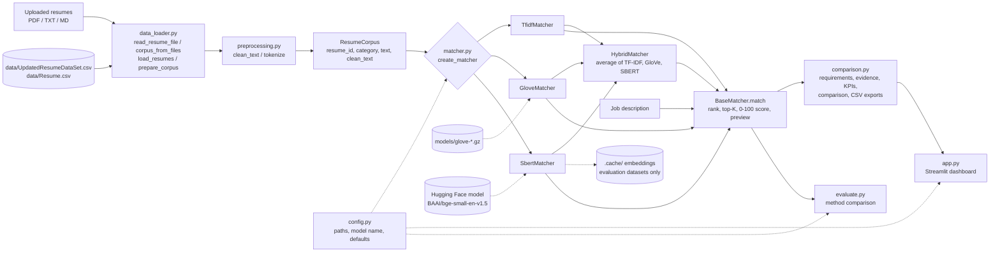

# Resume Matcher

Rank uploaded resumes against a job description using three NLP text-similarity techniques
(**TF-IDF**, **GloVe** word embeddings and **Sentence-BERT**) plus a **Hybrid** that averages all
three, through one shared interface and a Streamlit recruitment-analytics dashboard with KPIs,
charts, a shortlist and side-by-side comparison of up to five candidates.

---

## 1. Problem statement

Recruiters often receive far more resumes than they can read closely. Keyword search
misses candidates who describe the same skill in different words, and reading every
resume by hand is slow. This project explores how well different text-representation
techniques can **rank a pool of resumes by their similarity to a job description**, so a
human reviewer can start with the most relevant ones.

## 2. Objectives

1. Load and clean real public resume datasets: a tech-focused one (software, data, DevOps, QA roles) and a
   general one (2,484 resumes across 24 industries).
2. Implement three matching methods behind one interface:
   lexical (TF-IDF), averaged word embeddings (GloVe), and sentence embeddings (Sentence-BERT),
   plus a hybrid that averages the scores of all three.
3. Provide a web app to upload resumes, enter a job description, view ranked resumes, and compare and
   shortlist candidates using evidence taken from the resumes.
4. Compare the methods reproducibly on the same resumes and job descriptions.
5. Handle missing data, models and packages without crashing or giving misleading results.

## 3. Features

| Feature | Status |
|---|---|
| Dataset loading with automatic column detection (text / category / ID) | ✅ Implemented |
| Two real datasets for evaluation (tech roles / all industries) | ✅ Implemented |
| Repair of broken characters in the data (e.g. `Naïve` → `Naïve`) | ✅ Implemented |
| Handling of missing file, empty file, null text, malformed rows, duplicates | ✅ Implemented |
| Shared text preprocessing that keeps terms like `c++`, `c#`, `node.js`, `r` | ✅ Implemented |
| TF-IDF + cosine similarity matching | ✅ Implemented |
| GloVe average-embedding matching | ✅ Implemented (needs a ~134 MB download, see §10) |
| Sentence-BERT matching (`BAAI/bge-small-en-v1.5`, configurable) | ✅ Implemented (model downloads on first use) |
| Hybrid matching: equal average of TF-IDF, GloVe and Sentence-BERT (default in the app) | ✅ Implemented |
| On-disk cache of Sentence-BERT embeddings for the evaluation datasets (never for uploaded resumes) | ✅ Implemented |
| Clear "unavailable" status when GloVe/SBERT resources are missing | ✅ Implemented |
| Streamlit app: upload several resumes (PDF/TXT/MD), one empty job-description box, method & top-K selectors | ✅ Implemented |
| PDF text extraction for uploaded resumes (`pypdf`) | ✅ Implemented |
| Ranked results table with similarity score and contact-masked preview | ✅ Implemented |
| Per-resume card: job requirements *Included in Resume* / *Not Found in Resume* | ✅ Implemented |
| CSV download of results | ✅ Implemented |
| Dashboard KPIs: resumes processed, candidates ranked, strong matches (configurable threshold), average similarity | ✅ Implemented |
| Charts from the current run: score by candidate, score distribution, requirements found, requirement coverage | ✅ Implemented |
| Ranking search (file name or skill), sort (rank, score, requirements, name) and filters (shortlisted, strong, must mention) | ✅ Implemented |
| Candidate comparison of 2–5 candidates from the same run: score bars, skills, experience/education quotes, keywords, resume text, original file | ✅ Implemented |
| Candidate × requirement matrix and shared-skills view | ✅ Implemented |
| Deterministic, evidence-based comparison summary (no LLM, no hiring recommendation) | ✅ Implemented |
| Session-only shortlist with a "Shortlisted" filter | ✅ Implemented |
| Comparison CSV and skill-matrix CSV export (UTF-8, quoted, formula-safe) | ✅ Implemented |
| Evaluation script (timing + category-based Precision@K) | ✅ Implemented |
| Automated tests (pytest, 194 tests, offline) | ✅ Implemented |
| DOCX upload, OCR for scanned PDFs | ⏳ Not implemented |
| Human-labelled relevance judgments | ⏳ Not available |

## 4. Technologies

Python 3.13 (3.10+ should work), pandas, NumPy, scikit-learn (TF-IDF), pypdf (PDF text), pretrained GloVe vectors
(`glove-wiki-gigaword-100`), sentence-transformers / PyTorch (Sentence-BERT), Streamlit (UI) with Altair
charts (installed with Streamlit), pytest (tests).

## 5. System architecture



Core logic lives in the `resume_matcher/` package and has no UI code; `comparison.py` builds the
per-candidate view of one ranking without changing its scores. `app.py` (UI),
`evaluate.py` (comparison) and `explore_data.py` (data analysis) only call into it.
The app ranks resumes the user uploads; the two datasets are used by `evaluate.py` and `explore_data.py`.

## 6. Processing workflow

1. **Load**: in the app, extract the text of each uploaded file (PDF via `pypdf`, TXT/MD decoded as
   UTF-8 or Windows-1252) and use the file name as the resume ID; for evaluation, read the dataset CSV
   and detect the text/category/ID columns. Both paths then repair broken characters, drop resumes that
   are empty after cleaning, drop exact duplicates, and keep the original text for display.
2. **Preprocess**: lowercase, remove URLs and e-mail addresses, remove punctuation except `+ # .`
   inside terms, and collapse whitespace. Resumes and job descriptions use the same function.
3. **Index** (once per method): build TF-IDF vectors / GloVe document vectors / SBERT embeddings
   for all resumes.
4. **Query**: transform the job description in the same way and compute cosine similarity with
   every resume.
5. **Rank**: sort by similarity (stable sort, so ties keep dataset order), take the top K, and
   attach the ID, category, a 0–100 score and a contact-masked preview.

## 7. Matching algorithms

All four return **cosine similarity** (the hybrid returns the average of the three cosines), displayed as
`score = max(0, cosine) × 100`.
The score measures **text similarity only**. It is *not* a probability of suitability or of being
hired, and scores from different methods are not on comparable scales (GloVe scores are
typically 90+ for every resume because averaged word vectors are all fairly similar).

| Method | How it represents text | Strengths | Weaknesses |
|---|---|---|---|
| **TF-IDF** | Sparse vector of word weights: frequent in this resume, rare across all resumes. English stop words removed, sub-linear TF. Fitted on the resume corpus; the job description is transformed with the same vocabulary. | Fast (0.3 s to index 2,481 resumes), explainable, no download. | Exact word overlap only ("doctor" ≠ "physician"). Job-description words absent from the resumes are ignored. |
| **GloVe** | Mean of 100-d pretrained GloVe vectors of the non-stop-word tokens. Out-of-vocabulary words are skipped; a document with no known words gets a zero vector (similarity 0). | Captures related words. | Averaging loses word order and blurs long documents; scores are compressed near the top. |
| **Sentence-BERT** | `BAAI/bge-small-en-v1.5` transformer embedding (384-d, L2-normalized) of whitespace-normalized text. BGE is trained for search, so the job description gets the model's query instruction ("Represent this sentence for searching relevant passages: "); resumes are encoded as they are. | Understands related wording and context. | Slower; the model reads only about the first 512 word-pieces of each resume, so very long resumes are cut off. |
| **Hybrid** (recommended) | `(TF-IDF cosine + GloVe cosine + Sentence-BERT cosine) / 3`. If TF-IDF or GloVe knows none of the job description's words, the average uses the remaining methods. | Exact skill names, related words *and* overall meaning all count; best or joint-best in §13. | Needs both the GloVe file and Sentence-BERT; three indexes to build. GloVe's compressed scores add a near-constant amount, so it changes the ranking less than the other two. |

## 8. Repository structure

```
Resume-Matcher/
├── app.py                        # Streamlit dashboard (UI and per-session state only)
├── assets/app.css                # Dashboard styles (loaded by app.py)
├── evaluate.py                   # Compare methods: timing + category Precision@K
├── explore_data.py               # Dataset exploration (shape, nulls, categories, cleaning)
├── resume_matcher/               # Core logic (no UI)
│   ├── config.py                 # Paths, model name, defaults (env-var overridable)
│   ├── data_loader.py            # CSV + uploaded-file (PDF/TXT/MD) loading, validation, de-duplication
│   ├── preprocessing.py          # clean_text, tokenize, contact masking, previews
│   ├── skills.py                 # Job-description requirements and which ones each resume mentions
│   ├── matcher.py                # TF-IDF / GloVe / SBERT matchers + create_matcher()
│   └── comparison.py             # Candidate evidence, KPIs, filters, comparison, summary, CSV exports
├── tests/                        # pytest suite (synthetic fixtures, offline fakes)
├── demo_samples/                 # One job description + seven fictional resumes (TXT, PDF, CSV)
├── data/
│   ├── README.md                 # How to get both datasets
│   └── sample_job_descriptions.json   # 16 hand-written tech job descriptions used by evaluate.py
├── models/                       # Put GloVe vectors here (git-ignored)
├── .streamlit/config.toml        # Upload size limit, telemetry off
├── requirements.txt
└── pytest.ini
```

Generated and git-ignored: `.venv/`, `.cache/` (SBERT embeddings of the evaluation datasets), `results/` (evaluation CSVs),
`data/*.csv`, `models/*`.

## 9. Datasets

Both are real, public Kaggle resume datasets. They are git-ignored (third-party personal data); see
[`data/README.md`](data/README.md) for download steps. They are used for evaluation (§13) and data
exploration; the web app itself only ranks resumes that the user uploads.

| | Tech roles (default) | All industries |
|---|---|---|
| File | `data/UpdatedResumeDataSet.csv` | `data/Resume.csv` |
| Source | Kaggle *Resume Dataset* (gauravduttakiit); MIT-licensed mirror on Hugging Face `brackozi/Resume` | Kaggle *Resume Dataset* by Snehaan Bhawal |
| Columns | `Category`, `Resume` (no ID, so IDs are `row-<n>`) | `ID`, `Resume_str`, `Resume_html`, `Category` |
| Rows → used after cleaning | 962 → **166** (796 exact duplicates removed) | 2,484 → **2,481** (1 empty, 2 duplicates removed) |
| Categories | 25, mostly technical: Java / Python / DotNet / SAP / ETL Developer, Data Science, DevOps Engineer, Testing, Automation Testing, Database, Hadoop, Blockchain, Business Analyst, Web Designing, Network Security Engineer, plus some non-tech | 24 broad industries (INFORMATION-TECHNOLOGY, ENGINEERING, HR, ...); only about 30 resumes have a software/data job title |

Known gaps in the tech dataset: there is no frontend, mobile (Android/iOS) or systems-programming
category (7 resumes mention Android), so those job descriptions are ranked but not scored in §13.

Any CSV with a resume-text column works for evaluation: `python evaluate.py --data /path/to/file.csv`.

## 10. Installation

**macOS / Linux**

```bash
git clone https://github.com/YashAgarwal2309/Resume-Matcher-Project-.git
cd Resume-Matcher-Project-
python3 -m venv .venv
source .venv/bin/activate
pip install -r requirements.txt
```

**Windows (PowerShell)**

```powershell
git clone https://github.com/YashAgarwal2309/Resume-Matcher-Project-.git
cd Resume-Matcher-Project-
py -m venv .venv
.venv\Scripts\Activate.ps1
pip install -r requirements.txt
```

The web app needs no dataset: it ranks the resumes you upload. The datasets (see §9) are only used by
`evaluate.py` and `explore_data.py`.

### Optional: GloVe vectors (~134 MB)

```bash
curl -L -o models/glove-wiki-gigaword-100.gz \
  https://github.com/RaRe-Technologies/gensim-data/releases/download/glove-wiki-gigaword-100/glove-wiki-gigaword-100.gz
```

This is the same `glove-wiki-gigaword-100` model the original script loaded through
`gensim.downloader`; it is read directly, so gensim is not required. The Stanford file
`glove.6B.100d.txt` placed in `models/` also works, or set `GLOVE_PATH`.
Without the file, the app shows GloVe as unavailable.

### Optional: Sentence-BERT

Installed by `requirements.txt`. The default model, `BAAI/bge-small-en-v1.5` (~130 MB), is downloaded from
Hugging Face on first use and cached. The first SBERT run per dataset also encodes all resumes (measured: about
8 s for 166 and 41 s for 2,481 resumes on an Apple-silicon laptop, plus the one-time model download), and
`evaluate.py` saves the dataset embeddings to `.cache/` so later runs only load the model. The web app never
writes embeddings of uploaded resumes to disk; it keeps them in the browser session's memory. The Hybrid method uses the same model
(and also needs the GloVe file).
To use a different model: `export SBERT_MODEL=all-MiniLM-L6-v2` (the previous default). To force CPU:
`export SBERT_DEVICE=cpu`.

### Configuration (environment variables)

| Variable | Default |
|---|---|
| `RESUME_DATA_PATH` | unset: `evaluate.py` uses every dataset in `data/`; set it to use only one CSV |
| `GLOVE_PATH` | `models/glove-wiki-gigaword-100.gz` (or `models/glove.6B.100d.txt`) |
| `SBERT_MODEL` | `BAAI/bge-small-en-v1.5` |
| `SBERT_DEVICE` | auto (CUDA / Apple MPS / CPU) |

## 11. Running

```bash
streamlit run app.py          # web app at http://localhost:8501
python explore_data.py        # dataset statistics
python evaluate.py            # compare all methods on every dataset (add --methods tfidf sbert --top-k 10)
```

Auto-reload on file save is turned off in `.streamlit/config.toml` (it floods the console with
harmless `torchvision` tracebacks once Sentence-BERT is loaded), so restart the app after editing code.

**Demo flow:** paste the job description (the app lists the requirements it detects), upload the resumes
(select several PDF/TXT/MD files at once), choose an algorithm and how many candidates to display (defaults to
all uploaded resumes), and click **Match Resumes**. Ready-made demo input: `demo_samples/` (one job description
and seven fictional resumes in `demo_samples/pdf/`).

### Using the dashboard

**Supported resume formats:** PDF with a text layer, TXT and MD, up to 5 MB each. DOCX and scanned PDFs
(images only, no OCR) are not supported; unreadable or empty files are skipped with a message.

**Scores.** Each ranked resume gets `score = max(0, cosine similarity) × 100` from the selected method
(§7). It measures text similarity, not the chance of a good hire. Scores of different methods are on
different scales, so compare candidates only within one run.

**KPIs.** *Resumes processed* (readable uploads after duplicates are removed), *Candidates ranked* (top K),
*Strong matches* (ranked resumes with a score at or above the strong-match threshold) and *Average
similarity* (mean score of the ranked candidates). The threshold is set per method with the
"Strong match ≥" button; defaults are TF-IDF 25, GloVe 90, Sentence-BERT 70 and Hybrid 60
(`DEFAULT_STRONG_THRESHOLDS` in `resume_matcher/comparison.py`). They separate the three Data Science
resumes in `demo_samples/` from the rest for every method; they are a starting point, not a calibrated
cut-off. Changing the threshold never changes the ranking.

**Ranking tab.** Search by file name or skill, sort by rank, score, requirements found or name, and filter
to shortlisted candidates, strong matches, or resumes that mention chosen requirements. Each candidate's
card shows the requirements found / not found, experience and degree phrases quoted from the resume (or
*Not available*), keywords shared with the job description, and a contact-masked preview.

**Insights tab.** Similarity score by candidate (with the threshold), score distribution, requirements
found per resume, and how many resumes mention each requirement, all from the current run.

**Compare tab.** Choose 2 to 5 candidates in *Candidates to compare* (or with *Add to comparison* on a
card) and click **Compare Candidates**. All of them come from the same run, so they share one job
description, one method and one score scale. You get a short summary that states its criteria (score,
requirements found, shared and unique skills), one card per candidate (score bar, skills matched and not
found, experience, education, keywords, parsed resume text and the original uploaded file), a score chart,
a shared-skills panel and a candidate × requirement matrix. "Not found" means the resume text does not
mention it; the candidate may still have that skill.

**Shortlist.** Use the *Shortlisted* toggle on any card. A shortlist belongs to one set of uploaded resumes
plus one job description: it survives re-running or switching the method, while different uploads or a
different job description start a separate shortlist. It lives only in the browser session.

**Exports.** *Download results as CSV* (the ranking, unchanged format), *Download Comparison CSV* (one row
per compared candidate: candidate, rank, similarity score, method, requirements found, matched and
unconfirmed skills, experience and education phrases, shortlist status) and *Download Skill Matrix CSV*
(requirement × candidate, "found" / "not found"). Comparison exports are UTF-8 with a BOM so spreadsheet apps
show accents correctly, quote commas, quotes and line breaks, and prefix cells that start with `=`, `+`, `-`
or `@` with `'` so they are not run as formulas. They contain candidate information: store and share them
carefully.

**Stale results.** Uploading different resumes clears the results. Editing the job description, method or
number of candidates keeps the old results on screen with a notice until **Match Resumes** is clicked again;
every new run resets the comparison selection.

## 12. Testing

```bash
python -m pytest            # 194 tests, run offline in about 10 s
```

The tests use tiny **synthetic** resumes (in `tests/conftest.py`), not the real dataset, plus fake
GloVe vectors and a fake sentence model, so they need no downloads. They cover dataset loading
(valid, missing, empty, header-only, malformed rows, nulls, duplicates, missing metadata),
preprocessing (including broken-character repair), reading uploaded PDF/TXT/MD resumes (with a tiny
generated PDF), the dataset list, the
evaluation script, score bounds, descending ranking, top-K limits, identical output columns across all
matchers, the hybrid's weighting and fallback, the BGE query instruction, unavailable GloVe file, missing `sentence-transformers` package, a simulated model
download failure, embedding caching, and the Streamlit UI (via `streamlit.testing.AppTest`: empty start,
multi-file upload, unreadable files, results cleared when uploads change). `tests/test_comparison.py` and the
dashboard tests in `tests/test_app.py` cover selecting 2–5 candidates (and refusing 0, 1 or 6), duplicate file
names, empty text, jobs without requirements, the evidence extraction, the summary, CSV escaping and
formula-safety, scores shown equal to `BaseMatcher.match`, KPIs and the threshold, search and filters, the
shortlist, the stale-results notice, a new run clearing the comparison, and that uploaded resumes are never
cached on disk.

## 13. Evaluation

`python evaluate.py` runs every method on every available dataset with the **16 hand-written tech job
descriptions** in `data/sample_job_descriptions.json`: SDE, SWE, Application, Backend, Frontend,
Full-Stack, Mobile (Android/iOS) and Systems Software roles, plus Data Analyst, Data Scientist/ML Engineer,
AI Engineer (NLP), IT Business Analyst, DevOps, QA/Automation Test, Database Developer and Data Engineer.

**Important:** the datasets have **no human relevance judgments**. As a proxy, a resume counts as
"relevant" if its dataset `Category` is in the job's `relevant_categories` (for example
*Backend Developer* → Java / Python / DotNet Developer). This is a rough sanity check, not a true accuracy
measure, and the category mapping is our own judgement. Jobs with no fitting category in a dataset
(Mobile and Systems Software in both; most data/QA/DevOps roles in `Resume.csv`) are ranked but not scored.

Results measured on 27 Oct 2026 (Apple-silicon Mac, top-K = 5; reproducible, since all methods are
deterministic). Timings exclude the one-time model download; SBERT times are first-run encoding.

**Tech roles dataset (166 resumes, 14 of 16 jobs scored)**

| Method | Mean Precision@5 (category proxy) | Top-1 in a relevant category | Index build | Mean query |
|---|---|---|---|---|
| TF-IDF | 0.786 | 12 / 14 | 0.02 s | 0.002 s |
| GloVe (100-d) | 0.443 | 10 / 14 | 3.7 s (loading 400k vectors) | 0.002 s |
| Sentence-BERT (bge-small) | 0.814 | 13 / 14 | 8.0 s first run | 0.013 s |
| **Hybrid** (TF-IDF + GloVe + bge-small) | **0.829** | **14 / 14** | 5.2 s (GloVe load; SBERT embeddings cached) | 0.014 s |

**All industries dataset (2,481 resumes, 6 of 16 jobs scored)**

| Method | Mean Precision@5 (category proxy) | Top-1 in a relevant category | Index build | Mean query |
|---|---|---|---|---|
| TF-IDF | 0.267 | 2 / 6 | 0.44 s | 0.005 s |
| GloVe (100-d) | 0.367 | 2 / 6 | 5.1 s | 0.003 s |
| Sentence-BERT (bge-small) | 0.333 | 1 / 6 | 41.3 s first run | 0.015 s |
| **Hybrid** (TF-IDF + GloVe + bge-small) | **0.333** | **4 / 6** | 7.2 s (GloVe load; SBERT embeddings cached) | 0.021 s |

Observations (not general conclusions; 14 and 6 queries are too few):
- On the tech dataset (the project's focus) the Hybrid scored highest and put a relevant resume first for all
  14 scored jobs. TF-IDF alone is strong because tech job descriptions contain exact skill names
  (Spring Boot, Selenium, Hadoop, Jenkins) that also appear in matching resumes; Sentence-BERT adds related
  wording, and the mix beats each method on its own. On `Resume.csv` the Hybrid also had the most
  relevant first results (4 / 6).
- GloVe averaging blurs these specific terms into generic "computer" vocabulary, so it ranks many
  different developer resumes almost equally (scores 85–97).
- On `Resume.csv` all methods score low because it contains few real software resumes and its categories are
  broad industries. Differences there are one or two resumes out of 30 and should not be over-read; note that
  the previous model (MiniLM) put a relevant resume first more often on this dataset (5 / 6).
- Per-job rankings are saved to `results/evaluation_per_job.csv`.

### Model selection (27 Oct 2026)

The Sentence-BERT model and the Hybrid were chosen by comparing alternatives on the tech dataset (same 14 scored
jobs; Precision@5 / Precision@10):

| Approach | P@5 | P@10 | Decision |
|---|---|---|---|
| `all-MiniLM-L6-v2` (previous default) | 0.686 | 0.557 | replaced |
| `all-mpnet-base-v2` | 0.629 | 0.464 | rejected (worse and slower) |
| `BAAI/bge-base-en-v1.5` | 0.771 | 0.614 | rejected (bigger, not better) |
| **`BAAI/bge-small-en-v1.5`** | **0.814** | **0.686** | **new default** |
| Hybrid 0.5 TF-IDF + 0.5 bge-small (two methods) | 0.829 | 0.729 | first hybrid; replaced by the three-method average |
| **Hybrid: average of TF-IDF + GloVe + bge-small** | **0.829** | **0.657** | **current hybrid, app default** |
| Hybrid weights 0.3 / 0.7 (min-max normalised), rank fusion (RRF) | 0.814–0.843 | 0.693–0.721 | not adopted: within noise of a simple average |
| BM25 instead of TF-IDF | 0.729 | 0.614 | rejected |
| Splitting resumes into chunks (best chunk counts) | 0.60–0.73 | 0.51–0.61 | rejected for every model |
| GloVe weighted by IDF | 0.471 | 0.343 | not adopted (small gain) |

The three-method hybrid was chosen so that every technique in the project contributes. It ties the
two-method version on Precision@5 and top-1 for the tech dataset, is a little lower on Precision@10
(0.657 vs 0.729), and is better on `Resume.csv` (Precision@5 0.333 vs 0.300, top-1 4 / 6 vs 3 / 6).
The model rows can be reproduced with `SBERT_MODEL=<model> python evaluate.py --methods sbert`; the BM25,
chunking, weighting, fusion and two-method hybrid rows came from a one-off comparison script that is not part
of the repository.
On the seven demo resumes (`demo_samples/`), the previous MiniLM model ranked the Python developer above one
Data Science resume; with bge-small, Sentence-BERT and the Hybrid rank the three Data Science resumes first,
then Python, Business Analyst, Java, and HR last.

## 14. Limitations and known issues

- No ground-truth relevance labels, so retrieval accuracy cannot be formally established (see §13).
- Sentence-BERT truncates long resumes (about 512 word-pieces, roughly one page), so text beyond that is ignored.
- GloVe averaging compresses scores near the top, making small score differences hard to interpret.
- TF-IDF only matches exact words; job-description words absent from all resumes are ignored.
- Resumes can be PDF, TXT or MD (max 5 MB each); DOCX is not supported, and scanned PDFs (images without a
  text layer) cannot be read because there is no OCR. PDF text extraction can change spacing or letter case.
- The datasets' categories are job titles, not skills, and a resume can fit several categories.
- The tech dataset is small (166 unique resumes) and has no frontend, mobile or systems-programming category.
- Phone masking in previews is heuristic (10+ digit sequences); unusual formats may not be masked.
- Malformed CSV rows are skipped by pandas without a per-row count.
- Experience is only shown when a resume states it ("4 years of experience"); it is never computed from dates.
  Education shows degree mentions found by a pattern list (B.Tech, MBA, Master of ..., and so on); unusual
  degree names are missed and PDF line breaks can add the institution to the quote.
- The strong-match thresholds are heuristic defaults (see "Using the dashboard"), not validated cut-offs.
- Shared keywords are plain word overlap with the job description and can include generic words.
- The shortlist and comparison selection last only for the browser session; there is no saved history.

## 15. Privacy, fairness and responsible use

- The datasets contain real (partly anonymized) resumes. They are git-ignored and must not be re-published.
- Previews mask e-mail addresses, URLs and phone numbers; only the ID, category and a short preview are shown.
- Uploaded resumes are only read as text (PDF text extraction or UTF-8 decoding). Their text, the matchers built
  from them, the results and the shortlist are kept in the browser session's memory (`st.session_state`): they
  are not shared with other users, not cached across sessions and never written to disk (the app does not use
  the on-disk embedding cache). Only the public GloVe table and Sentence-BERT model are shared between sessions.
- Comparison exports contain file names, skills and short experience/education quotes, but no full resume
  text or contact details. They are still candidate data; handle them confidentially.
- The comparison summary is deterministic and uses only scores and requirement matches. It does not rate
  people, infer personal characteristics or recommend a hire.
- Text similarity can reproduce biases in wording, such as gendered language, school names or employment gaps,
  and the pretrained embeddings carry biases from their training data. **Use rankings to support human
  review, never to reject candidates automatically.**

## 16. Future enhancements

- A better way to use resumes longer than 512 word-pieces (simple chunking lowered precision, §13).
- Smarter requirement extraction (today: a skill vocabulary with aliases plus items listed after cues
  such as "Required:"; it does not understand synonyms outside that vocabulary).
- DOCX support and OCR for scanned PDF resumes.
- A small human-labelled relevance set to compute real Precision/Recall/nDCG.
- Bias auditing (for example score distributions across categories).
- An optional, consent-based way to save shortlists between sessions.

## History

The original `explore_data.py` (first commit) ran the dataset analysis and the TF-IDF, GloVe and
SBERT experiments in one script. Those experiments are now reusable modules in
`resume_matcher/matcher.py`, compared by `evaluate.py`; `explore_data.py` keeps the dataset-analysis role.
